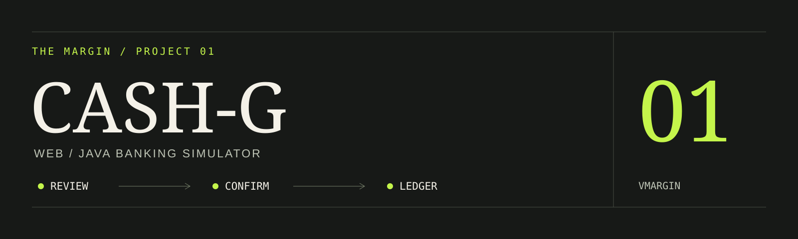
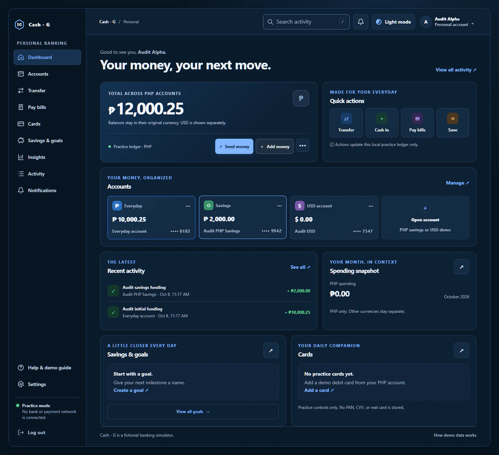
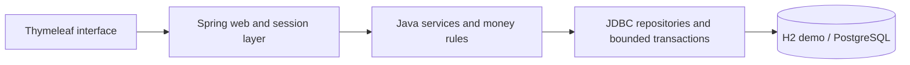

# CASH-G Web

**A Java banking simulator, from service rules to reviewed money flows.**

CASH-G Web is an educational Spring Boot and Thymeleaf application with JDBC persistence. It is the web evolution of a [separate Java Swing desktop project](https://github.com/vmargin/banking-app), using synthetic accounts and practice money.

[Case study](https://vmargin.github.io/projects/cash-g/) · [Desktop v1](https://github.com/vmargin/banking-app)

> **Demo status, October 22, 2026:** the previously published host, https://cashg.onrender.com, returns HTTP 404 at both the root and /login. Use the isolated local demo below. This application is a simulator, not a bank or payment service.



## Implemented workflows

- Multiple PHP accounts and a separate USD practice account; totals keep currencies separate.
- Same-currency customer transfers with a server-held review and confirmation step.
- Money requests that require the named payer's review before any ledger change.
- Fictional bill payments, savings-goal funding and returns, receipts, statement CSV, and activity categories.
- Owner-scoped account activity and notifications, PIN changes, help, and settings.
- Display-only practice cards with local controls; no real card-network operation occurs.

No external bank, biller, payment network, SMS, identity, or biometric provider is connected.

## Architecture



Services own application rules. JDBC transactions keep balance changes, goal reserves, operation claims, and paired ledger entries consistent. Internal database IDs, customer-facing account numbers, and operation references serve different purposes. The demo uses a persistent local H2 file; PostgreSQL maintenance operations are explicit.

**Stack:** Java 21, Spring Boot 3.5, Thymeleaf, Spring Security, JDBC, PostgreSQL, H2, JUnit, Maven.

## Run the local demo

Install Temurin JDK 21. The repository includes the Maven Wrapper. On Windows PowerShell:

```powershell
git clone https://github.com/vmargin/cashg.onrender.com.git
cd cashg.onrender.com
.\scripts\dev.ps1 -Task demo
```

Open http://127.0.0.1:8081/login. No database credentials are needed for this demo profile.

| Synthetic user | Mobile | PIN |
| --- | --- | --- |
| Miguel Santos | `09990000001` | `1234` |
| Maria Reyes | `09990000002` | `1234` |

The demo preserves its local H2 data between runs. Enter synthetic data only, including PINs. For another operating system with JDK 21, use `./mvnw spring-boot:run -Dspring-boot.run.profiles=demo`.

## Verify

```powershell
.\scripts\dev.ps1 -Task compile
.\scripts\dev.ps1 -Task test
.\scripts\dev.ps1 -Task verify
```

H2 migration and money-flow tests do not require PostgreSQL credentials. PostgreSQL-backed checks need a separately configured isolated local database. A green build is not evidence that the hosted demo is available.

## Contribution and limits

I hand-coded desktop v1's Java interface, services, JDBC persistence, and tests. Web v2 is an AI-assisted adaptation, including redesign, development, and deployment. I review features, expected outputs, and behavior. Legacy Swing classes remain as earlier learning material; this repository launches the web application.

[Product scope](PRODUCT.md) · [Design](DESIGN.md) · [Screenshot provenance](.github/media/README.md)

---

[More projects](https://github.com/vmargin) · [Portfolio](https://vmargin.github.io/) · [LinkedIn](https://www.linkedin.com/in/vmargin/)

## Sauron development workflow

See [Sauron workflow](context/SAURON-WORKFLOW.md) for automatic task guidance, Fellowship roles, frontend design routing, and integration checks. Run `node scripts/sauron-workflow.mjs check` with Node 22 or later.

For the pinned Sauron development harness (Node 22 or later):

```powershell
npm ci --prefix tools/sauron --ignore-scripts --no-audit --no-fund
node scripts/sauron.mjs doctor
node scripts/sauron.mjs run "Implement the requested project change"
```

The last command performs Sauron skill lookup and opens Codex with the project workflow. It requires a signed-in Codex CLI. Fellowship roles load in the next Codex session. Use `node scripts/sauron.mjs init` when reinitializing the harness so project-specific Java instructions are preserved.